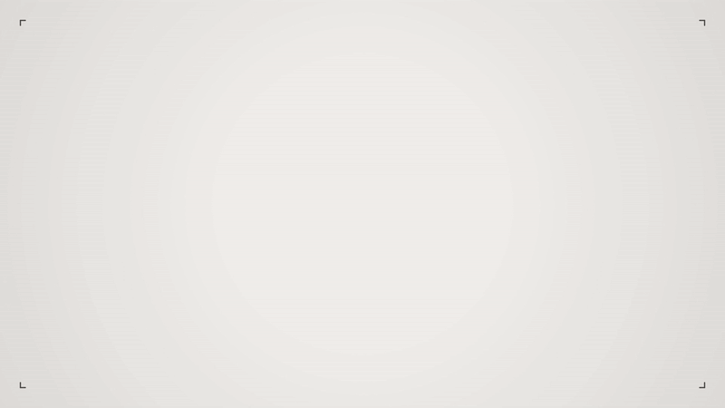
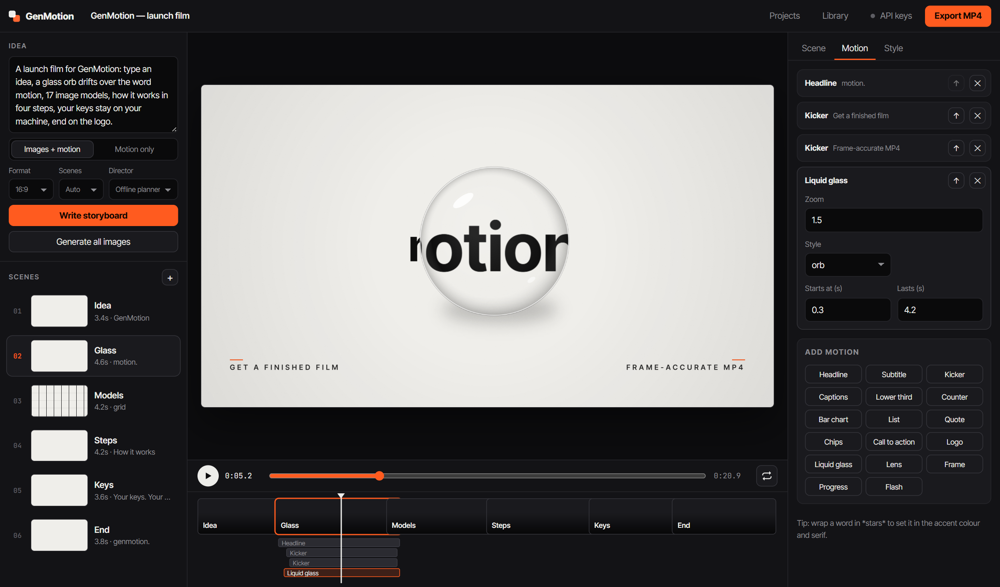
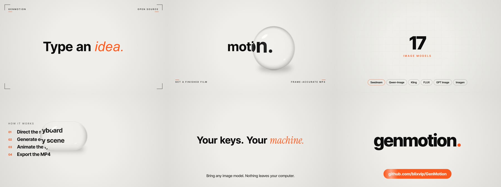

<h1 align="center">GenMotion</h1>

<p align="center">
  
</p>

<p align="center">
  <b>Type an idea. Get a finished motion-graphics video.</b><br>
  GenMotion directs a storyboard, paints every scene with the image model you pick (the best Western <i>and</i> Chinese models), animates kinetic type and graphics over it, and exports a frame-accurate MP4. Runs on your machine. Bring your own API keys.
</p>

<p align="center">
  <a href="#quick-start">Quick start</a> ·
  <a href="#image-models">Image models</a> ·
  <a href="#directors">Directors</a> ·
  <a href="#motion-library">Motion library</a> ·
  <a href="#how-it-works">How it works</a> ·
  <a href="#add-a-model">Add a model</a>
</p>

<p align="center"><sub>The film above was made in GenMotion. Its storyboard is <a href="web/demo.genmotion.json"><code>web/demo.genmotion.json</code></a> and opens as the starter project. <a href="docs/demo.mp4">Watch the MP4</a>.</sub></p>

---

## What it does

1. **Direct.** Describe the video in a sentence. A text model of your choice writes a storyboard: scenes, image prompts, a shared visual look, motion layers, camera moves, transitions and a palette.
2. **Generate.** Every scene's image is painted by the model you choose: Seedream, GPT Image, Nano Banana, Imagen, FLUX, Qwen-Image, Kling, Ideogram, Recraft, Wan, Hunyuan and more. Generate one at a time or all at once, compare takes and keep the best.
3. **Animate.** Kinetic headlines, captions, counters, charts, lower thirds, lists, quotes, call-to-action buttons, liquid glass and logo reveals move over slow camera moves, with film grain and vignette on top.
4. **Export.** One click renders every frame at its exact time and encodes a 1080p H.264 MP4 (16:9, 9:16 or 1:1) with optional music.

Prefer pure motion graphics? Switch to **Motion only** and GenMotion makes a type-and-graphics film with no image model at all.

<p align="center"></p>

<p align="center"></p>

## Quick start

You need **Node.js 20+** and **Chrome or Edge** (export uses WebCodecs). There are no dependencies to install.

```bash
git clone https://github.com/blixvip/GenMotion.git
cd GenMotion
npm start            # or: node server/index.mjs --open
```

Open **http://127.0.0.1:4520**, click **API keys**, and paste a key for at least one image model and one text model. That's it.

- Keys are saved to `.env` in the project folder (you can also copy `.env.example` to `.env` and fill it in by hand).
- Keys stay on your computer. The browser only ever sees "saved ••••1234".
- With no keys at all you can still use the full editor, upload your own images and export. An offline planner writes the storyboard.

## Image models

| Model | Maker | Region | Key | Good at |
|---|---|---|---|---|
| **Seedream 4.0** | ByteDance | 🇨🇳 | `ARK_API_KEY` | 2K–4K output, sharp text, great faces |
| **GPT Image** | OpenAI | 🌍 | `OPENAI_API_KEY` | Long prompts, readable text |
| **Gemini Image (Nano Banana)** | Google | 🌍 | `GEMINI_API_KEY` | Fast, cheap, consistent scenes |
| **Imagen 4** (standard / ultra / fast) | Google | 🌍 | `GEMINI_API_KEY` | Photoreal detail |
| **FLUX 1.1 Pro / Ultra / Kontext** | Black Forest Labs | 🌍 | `BFL_API_KEY` | Cinematic photoreal looks |
| **Qwen-Image** | Alibaba | 🇨🇳 | `DASHSCOPE_API_KEY` | Best-in-class text in images, EN + 中文 |
| **Kling Image** | Kuaishou | 🇨🇳 | `KLING_ACCESS_KEY` + `KLING_SECRET_KEY` | Rich cinematic frames |
| **Ideogram 3.0** | Ideogram | 🌍 | `IDEOGRAM_API_KEY` | Typography, posters |
| **Recraft V3** | Recraft | 🌍 | `RECRAFT_API_KEY` | Design-grade illustration |
| **Wan 2.2** | Alibaba | 🇨🇳 | `DASHSCOPE_API_KEY` | Film-like lighting |
| **Hunyuan Image** | Tencent | 🇨🇳 | `TENCENT_SECRET_ID` + `TENCENT_SECRET_KEY` | Vivid, detailed scenes |
| **CogView-4** | Zhipu AI | 🇨🇳 | `ZHIPU_API_KEY` | Chinese prompts and text |
| **MiniMax Image-01** | MiniMax | 🇨🇳 | `MINIMAX_API_KEY` | Cheap, consistent characters |
| **Stable Image Ultra / Core / SD3** | Stability AI | 🌍 | `STABILITY_API_KEY` | Flexible styles |
| **Grok Imagine** | xAI | 🌍 | `XAI_API_KEY` | Punchy, few refusals |
| **fal.ai** (any model id) | fal | 🌍 | `FAL_KEY` | One key for hundreds of models, incl. Hunyuan, Qwen, Seedream |
| **Replicate** (any model) | Replicate | 🌍 | `REPLICATE_API_TOKEN` | One key for thousands of community models |

Chinese providers default to their **international** endpoints (BytePlus, Alibaba Cloud International, Kling Singapore, minimax.io). Mainland accounts flip one variable each; see `.env.example`.

## Directors

The director is the text model that turns your idea into a storyboard. Any one is enough. **Auto** uses the first one you have a key for.

| Director | Key | Default model |
|---|---|---|
| Claude | `ANTHROPIC_API_KEY` | `claude-sonnet-5-5` |
| GPT | `OPENAI_API_KEY` | `gpt-5-mini` |
| Gemini | `GEMINI_API_KEY` | `gemini-2.5-flash` |
| DeepSeek 🇨🇳 | `DEEPSEEK_API_KEY` | `deepseek-chat` |
| Qwen 🇨🇳 | `DASHSCOPE_API_KEY` | `qwen-plus` |
| Kimi 🇨🇳 | `MOONSHOT_API_KEY` | `kimi-k2-0905-preview` |
| GLM 🇨🇳 | `ZHIPU_API_KEY` | `glm-4.6` |
| MiniMax 🇨🇳 | `MINIMAX_API_KEY` | `MiniMax-M2` |
| Grok | `XAI_API_KEY` | `grok-4` |
| OpenRouter (any model) | `OPENROUTER_API_KEY` | `anthropic/claude-sonnet-5.5` |

Override any default with `<ID>_DIRECTOR_MODEL`, e.g. `DEEPSEEK_DIRECTOR_MODEL=deepseek-reasoner`. Set `GENMOTION_DIRECTOR=kimi` to make one the Auto choice.

## Motion library

Every layer is drawn on a canvas, so the preview and the export match frame for frame. All of them work in 16:9, 9:16 and 1:1.

| Layer | What it does |
|---|---|
| **Headline** | Kinetic title with six reveals: rise, blur, type, split, mask, scale. `*Starred*` words switch to the accent serif. |
| **Subtitle** | Supporting line that blurs in word by word |
| **Kicker** | Small uppercase label with a drawn rule |
| **Captions** | Word-by-word captions with the current word highlighted |
| **Lower third** | Name bar that wipes in with an accent stripe |
| **Counter** | Number that counts up, with prefix, suffix, decimals and a label |
| **Bar chart** | Up to six bars that grow in sequence, with live values |
| **List** | Numbered steps, staggered |
| **Quote** | Serif pull quote with attribution |
| **Chips** | Row of pill tags that pop in |
| **Call to action** | Accent button with a light sweep |
| **Logo** | Letter-by-letter wordmark reveal |
| **Liquid glass** | A glass orb or capsule that drifts across, magnifying and bending whatever is under it, with rim light and a contact shadow |
| **Lens** | A rounded square that sweeps across and inverts what it passes |
| **Frame** | Corner brackets, letterbox, grid or a drawn border |
| **Progress** | Thin progress line |
| **Flash** | Light-leak hit for a beat |

Also included: **8 camera moves** (push, pull, pan left/right, rise, fall, drift, still), **8 transitions** (cut, fade, dip, flash, wipe, slide, zoom, blur), 4 backgrounds (image, animated gradient, grid, solid), 8 palette presets, 6 typefaces, film grain, vignette and per-scene image darkening.

## Using the studio

| | |
|---|---|
| **Write storyboard** | Directs the idea in the box. <kbd>Ctrl</kbd>+<kbd>Enter</kbd> from the idea box. |
| **Generate all images** | Fills every image scene, three at a time. |
| **Scene tab** | Image prompt, model and version, regenerate, upload, earlier takes, camera, transition. |
| **Motion tab** | Add, edit, reorder and remove layers. Times are in seconds from the scene start. |
| **Style tab** | Palette, fonts, grain, vignette, frame rate, the shared image look, music. |
| **Timeline** | Click or drag to scrub. Drag a clip's right edge to change its length. |
| **Scene list** | Drag to reorder. Drop an image on the preview to use it in the selected scene. |
| **Keys** | <kbd>Space</kbd> play · <kbd>←</kbd>/<kbd>→</kbd> frame step (<kbd>Shift</kbd> = 1 s) · <kbd>↑</kbd>/<kbd>↓</kbd> scene · <kbd>Ctrl</kbd>+<kbd>Z</kbd> / <kbd>Ctrl</kbd>+<kbd>Shift</kbd>+<kbd>Z</kbd> undo/redo |

Projects autosave to `library/projects/`, and every generated image is kept in `library/images/` with its prompt and model. Provider links expire, so images are always downloaded. **Projects → Save .json** exports a portable storyboard.

## How it works

```
idea ──► director (any text model) ──► storyboard.json ──► image models ──► library/
                                              │                                │
                                              ▼                                ▼
                               canvas renderer (same code for preview and export)
                                              │
                                              ▼
                        WebCodecs H.264 + AAC ──► mp4-muxer ──► MP4
```

- **`server/`** is a zero-dependency Node server. It keeps keys server-side, calls the providers, polls async jobs (FLUX, DashScope, Kling, Hunyuan, Replicate), signs Kling (JWT) and Tencent (TC3-HMAC-SHA256) requests, and downloads results into the library. It binds to `127.0.0.1` and refuses requests from other hosts or other sites' pages.
- **`web/engine/storyboard.mjs`** defines and validates the storyboard. The server uses it to clean up director output, so a sloppy model can't break the editor.
- **`web/engine/render.mjs` + `layers.mjs`** draw a frame as a pure function of `(storyboard, time)`.
- **`web/engine/export.mjs`** steps through every frame, encodes with WebCodecs and muxes in the browser. Nothing is screen-recorded, so a slow machine gives a slower export, never a choppier one. A 17-second 1080p film exports in about 6 seconds on a mid-range PC.

## Add a model

One file in `server/providers/image/`, one line in `server/providers/index.mjs`:

```js
import { request, ProviderError } from '../util.mjs';

export default {
  id: 'mymodel', name: 'My Model', maker: 'Me', region: 'global',
  keys: ['MYMODEL_API_KEY'], signup: 'https://example.com/keys',
  models: ['v1'], defaultModel: 'v1',
  strengths: 'One line shown under the picker.',
  async generate({ prompt, aspect, model, negative, seed }, { key, signal, fetch }) {
    const data = await request(this.name, 'https://api.example.com/generate', {
      method: 'POST', signal, fetch,
      headers: { authorization: `Bearer ${key('MYMODEL_API_KEY')}` },
      json: { prompt, aspect_ratio: aspect, model }
    });
    if (!data.url) throw new ProviderError(this.name, 'no image in response');
    return { url: data.url };            // or { buffer, mime }
  }
};
```

`request()` handles timeouts and readable errors, `poll()` handles async jobs, and `SIZES` has per-API size tables. Add a test in `test/providers.test.mjs` with a scripted fake of the API.

## Development

```bash
npm test         # 37 unit tests: every provider against a scripted fake API, storyboard, director, env
npm run check    # end-to-end: starts a throwaway server and drives the HTTP API
npm run dev      # restart on change
```

## Notes

- **Costs** are billed by each provider to your own account. GenMotion adds nothing.
- **Content rules** are the providers'. A refused prompt shows the provider's reason.
- **Model ids move fast.** Every picker accepts the listed versions, and fal.ai / Replicate accept any id you type.

## License

MIT. `web/vendor/mp4-muxer.js` is © Vanilagy, MIT.
